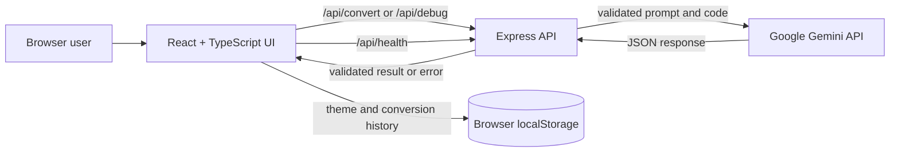

# SynCondeX Architecture

## Overview

SynCondeX is a browser-based code conversion and debugging workspace. The frontend is a React and TypeScript single-page application. It sends conversion and debugging requests to a Node.js/Express API, which validates requests and calls the Google Gemini API. AI credentials remain in the backend environment.



## Repository layout

```text
.
├── backend/
│   ├── src/server.ts       # Express app, API routes, Gemini integration
│   ├── package.json
│   └── tsconfig.json
├── frontend/
│   ├── src/App.tsx         # Main application and converter workspace
│   ├── src/Debugger.tsx    # AI debugger workspace and result display
│   ├── src/main.tsx        # React entry point
│   ├── src/style.css       # Shared day/night themes and responsive styles
│   ├── vite.config.ts      # Development proxy for /api
│   └── package.json
├── package.json            # Root development and build scripts
└── ARCHITECTURE.md
```

## Frontend

- **Framework:** React 18, TypeScript, Vite.
- **Code editor:** Monaco Editor, used for conversion input/output and debugger input/fixed output.
- **Icons:** lucide-react.
- **Styling:** shared CSS variables control light and dark themes; the selected theme and recent conversion history are stored in browser `localStorage`.
- **Code handling:** the UI supports the 20 language names declared in the frontend and backend language lists. It does not run user code locally.
- **API calls:** the UI uses relative `/api/...` URLs. Vite proxies these to `http://localhost:4000` during development.

Conversion and debugging share the source code and source language state in the main app. Debugging results are kept in the current React session; conversion history is stored locally and is not sent to the API as history.

## Backend

- **Runtime:** Node.js with TypeScript, Express, and the Google GenAI SDK.
- **Request parsing:** JSON body size is capped at 200 KB. Zod schemas validate supported language names, non-empty source code up to 50,000 characters, operation mode, and AI response structure.
- **Provider configuration:** `GEMINI_API_KEY` is read server-side. `GEMINI_MODEL` selects the model, with a configured default when omitted.
- **CORS:** the backend allows `FRONTEND_ORIGIN`, defaulting to `http://localhost:5173`.
- **Timeouts:** Gemini requests have a 60-second timeout. API errors are returned as JSON with an appropriate HTTP status.

### Routes

| Route | Purpose | Request | Success response |
|---|---|---|---|
| `GET /api/health` | Report whether an AI key is configured | None | `{ ok, provider }` |
| `POST /api/convert` | Convert source code | `{ sourceLanguage, targetLanguage, code }` | `{ success, convertedCode, summary, warnings }` |
| `POST /api/debug` | Analyze or suggest fixes for code | `{ language, code, mode }`, where mode is `analyze` or `fix` | `{ success, status, summary, issues, correctedCode?, changes, warnings, explanation }` |

The convert route retries selected transient Gemini failures once. The debug route validates the returned JSON and reports provider, timeout, and malformed-response failures without replacing the user's source code. No compiler or runtime validation is performed.

## Request flows

### Code conversion

1. The user selects source and target languages and enters code.
2. The frontend rejects empty input and identical source/target languages.
3. The frontend sends a JSON request to `POST /api/convert`.
4. The backend validates the payload and checks provider configuration.
5. The backend asks Gemini for JSON containing converted code, a summary, and warnings.
6. The backend parses and validates the AI response before returning it.
7. The frontend displays the result and stores a limited recent-history record locally.

### AI debugging

1. The user selects a language and either Analyze only or Find and fix.
2. The frontend sends the language, source code, and mode to `POST /api/debug`.
3. The backend instructs Gemini to treat source contents as untrusted code, not instructions, and not to execute the code.
4. The backend validates the structured analysis before returning it.
5. The frontend displays issues, possible warnings, explanations, and (in fix mode) suggested corrected code in a separate editor.
6. The original source remains unchanged unless the user explicitly confirms Replace original.

## Security and data boundaries

- The Gemini API key is only read by the backend and must not be placed in frontend variables or source files.
- Submitted source code is sent to the configured Gemini provider for the requested operation. Avoid submitting secrets or sensitive code unless provider terms and organizational policy permit it.
- User code and generated fixes are not executed by the application.
- AI analysis is static and may be incomplete, especially for runtime behavior, dependencies, and logical correctness that depends on intended behavior.
- The backend validates shapes and size limits, but the application does not provide authentication, user accounts, persistent server-side storage, or per-user rate limiting.

## Configuration and commands

Create `backend/.env` with at least:

```dotenv
GEMINI_API_KEY=your-key
# Optional
GEMINI_MODEL=your-compatible-model
PORT=4000
FRONTEND_ORIGIN=http://localhost:5173
```

Install dependencies and run both development servers from the repository root:

```bash
npm install
npm --prefix frontend install
npm --prefix backend install
npm run dev
```

The frontend is served at `http://localhost:5173`; the API listens on `http://localhost:4000` by default. Build both applications with:

```bash
npm run build
```

For deployment, serve the built frontend and configure the hosting proxy to send `/api` requests to the backend. Set `FRONTEND_ORIGIN` to the deployed frontend origin. Keep `.env` files and secrets out of source control.
